# Neural Arena

Different kinds of neural network, trained in three different ways, on four control tasks, all scored the same way.

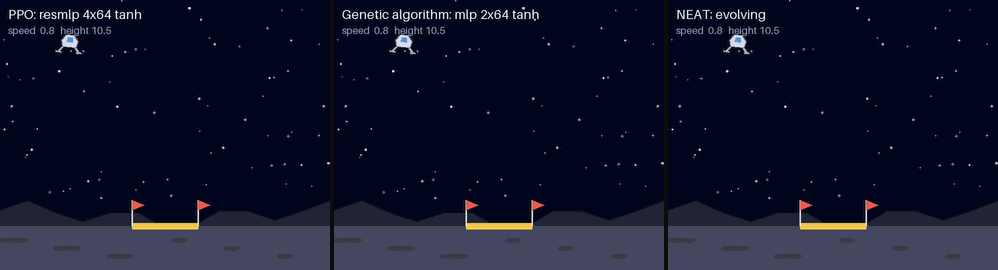

*The best agent from each training method on the same landing scenario. Left: gradient descent (PPO). Middle: genetic algorithm. Right: NEAT.*

The question behind it: if you hold the task fixed, how much do the **network style** (activation functions, layers, recurrent or not) and the **training method** (gradient descent, a genetic algorithm, or NEAT evolving its own wiring) matter?

**What came out of 408 training runs:**

- **No training method won everywhere.** PPO was far ahead on the hardest control task (the drone: 6.9 waypoints, against 2.5 for the genetic algorithm and 1.9 for NEAT). The genetic algorithm was far ahead on the lander with a blinking beacon (76% landings, against 42% for PPO). On the plain lander and the racer all three finished level.
- **For PPO, ReLU-type activations were best and sigmoid was worst.** Leaky ReLU and ReLU topped the ranking; a sigmoid network never landed once. The genetic algorithm ranked them differently: tanh and sin did well and ReLU was unreliable.
- **Depth mattered more than width.** With PPO, one hidden layer of 16, 64 or 256 units mostly failed to learn the landing in the budget (0%, 6% and 42%), while two layers of 64 landed 98% of the time and four layers 100%.
- **Softmax as a hidden layer broke the network.** Sigmoid-then-softmax was the worst style tested. A sigmoid layer sandwiched between ReLU and tanh was fine.
- **NEAT solved the lander and the racer with networks of 60 to 100 weights**, about 50 to 200 times smaller than the fixed networks. Letting it evolve its own activation functions did not beat simply fixing one.
- **Gradient descent needed far less experience, evolution needed similar time.** PPO used 10 to 25 times fewer environment steps, but simulating a whole population in one batch is cheap, so every method trained in tens of seconds to about three minutes.

Everything here is written from scratch in NumPy and PyTorch: the environments, PPO, the genetic algorithm and NEAT. There is no Gym or physics engine to install.

## Contents

- [The four tasks](#the-four-tasks)
- [What was compared](#what-was-compared)
- [Results](#results)
- [How the scores were measured](#how-the-scores-were-measured)
- [What this does not show](#what-this-does-not-show)
- [Run it yourself](#run-it-yourself)
- [What is in the repository](#what-is-in-the-repository)

## The four tasks

Each one is a small 2-D simulation with a handful of sensors and a few discrete actions. They are vectorised (hundreds of copies stepped at once in NumPy), which is what makes evolving a population of networks practical on a CPU.

| Task | What the agent has to do | Sensors | Actions | Score |
|---|---|---|---|---|
| **Lander** | Bring a spacecraft down gently on the pad from a random start | 6: position, speed, tilt, spin | 4: nothing, turn left, main engine, turn right | landing rate |
| **Memory Lander** | The same, but the pad is somewhere different every time and its position is only shown by a blinking beacon (on for ¼ s, off for ¾ s) | 8: the six above, pad position (zero while the beacon is off), beacon on or off | 4 | landing rate |
| **Drone** | Fly a two-rotor drone through as many waypoints as possible in 25 s, without leaving the arena | 11: position, speed, tilt, spin, where the next two waypoints are | 4: each rotor on or off | waypoints reached |
| **Racer** | Drive a car round a random track it has never seen, for 30 s, without touching the edge. Grip is limited, so it has to brake for corners | 10: nine distance rays to the track edge, speed | 6: steer left, straight or right, each with accelerate or brake | laps completed |

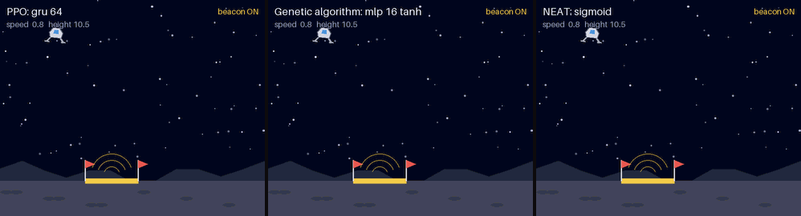

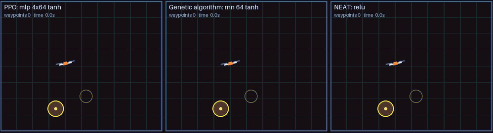

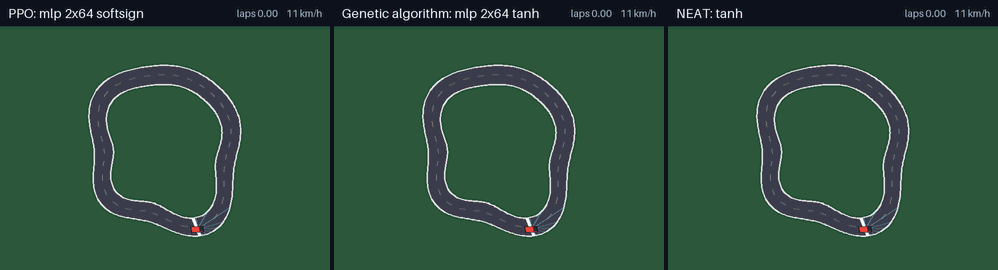

*In each GIF the three panels are the best PPO, genetic algorithm and NEAT agents on the same scenario, which none of them saw in training. The scenario is chosen by a rule rather than by eye: out of 20 candidates, it is the one where each agent's result is closest to its own average.*

## What was compared

**Three ways of training**

- **PPO** (proximal policy optimisation): the standard gradient-descent method for this kind of task. The network is nudged by backpropagation after every batch of experience.
- **Genetic algorithm (GA)**: no gradients. A population of 128 networks with the same shape plays a few episodes each; the best fifth are copied with random noise added to their weights (and sometimes mixed with another parent), and the rest are thrown away.
- **NEAT**: evolution that also designs the network. Every network starts with no hidden nodes at all and grows them by mutation. Run in two flavours: every hidden node uses one fixed activation function (tanh, relu or sigmoid), or each node carries its own activation function and a mutation can swap it for another (tanh, sigmoid, relu, sin, gaussian, abs, linear).

**Network styles** (trained by PPO, and a selection by the GA too)

- **12 activation functions** on the same two-layer network: relu, leaky relu, elu, gelu, silu (swish), tanh, sigmoid, softsign, softplus, sin, gaussian, and identity (no activation at all, as a control).
- **8 shapes and kinds**: one layer of 16, 64 or 256 units; two layers of 64; four layers of 64; four layers of 64 with skip connections; an Elman recurrent network; a GRU.
- **7 mixed stacks**, where each layer has a different activation, for example sigmoid then softmax, or relu then sigmoid then tanh.

That is 136 configurations and 408 training runs: every configuration on every task it applies to, three times with different random seeds. In total about 4.1 hours of CPU time and 1.4 billion simulated time steps.

## Results

Names like `mlp 2x64 tanh` mean a plain network with two hidden layers of 64 units and tanh activations. `a>b` means activation `a` in the first hidden layer and `b` in the second. Every table and every number below is generated from the files in [`results/runs/`](results/runs); the complete tables are in [RESULTS.md](RESULTS.md).

### 1. Which training method did best?

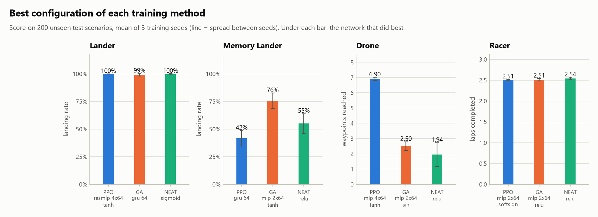

| Task | PPO | Genetic algorithm | NEAT | Random actions |
|---|---|---|---|---|
| **Lander** (landing rate) | 100% · resmlp 4x64 tanh · 27 s | 99% · gru 64 · 52 s | 100% · sigmoid · 37 s | 0% |
| **Memory Lander** (landing rate) | 42% · gru 64 · 102 s | 76% · mlp 2x64 tanh · 30 s | 55% · relu · 39 s | 0% |
| **Drone** (waypoints reached) | 6.90 · mlp 4x64 tanh · 66 s | 2.50 · mlp 2x64 sin · 68 s | 1.94 · relu · 57 s | 0.10 |
| **Racer** (laps completed) | 2.51 · mlp 2x64 softsign · 19 s | 2.51 · mlp 2x64 relu · 33 s | 2.54 · relu · 49 s | 0.04 |

Each cell is the best configuration of that method on that task: score, network, training time.

- **Lander.** All three methods land every time or nearly. It is the easy task and mostly tells you which network styles are broken (see below).
- **Memory Lander.** The genetic algorithm reached 76%, NEAT about 55% and PPO at best 42%. Most PPO runs sit near 30%, which is what you would get by ignoring the beacon and landing softly near the middle of the map. A spot check of eleven trained agents fits that picture: the PPO agents touched down gently 97 to 100% of the time, but where they came down had little to do with where the pad was (correlation between landing spot and pad position from 0.1 to 0.8, depending on the run), while for the GA's best networks that correlation was 0.92 to 0.98. PPO learned to land safely and then mostly stopped there. The winning GA networks were plain feed-forward ones with no memory, so they are not remembering in the usual sense; how they use the flashes was not investigated.
- **Drone.** PPO is in a different league: 6.9 waypoints against 2.5 and 1.9. This is the task that needs the most precise control, and it is where following a gradient pays off most.
- **Racer.** A three-way tie at about 2.5 laps. PPO gets there in a third of the time.

Recurrent networks did not unlock the memory task for anyone. The GRU was PPO's best at 42%, the GA with a GRU averaged 32% (its three seeds scored 12%, 2% and 82%), and allowing loops in NEAT did not help.

### 2. Learning curves

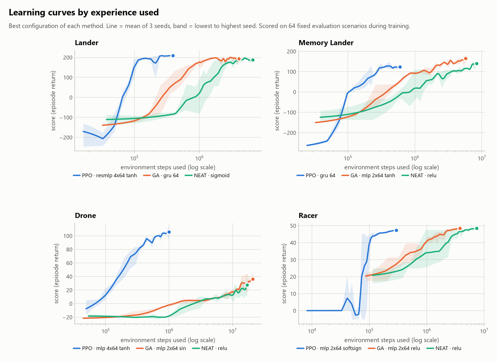

Measured by experience, PPO is 10 to 25 times more efficient: it has finished before evolution has properly started (the horizontal axis is logarithmic).

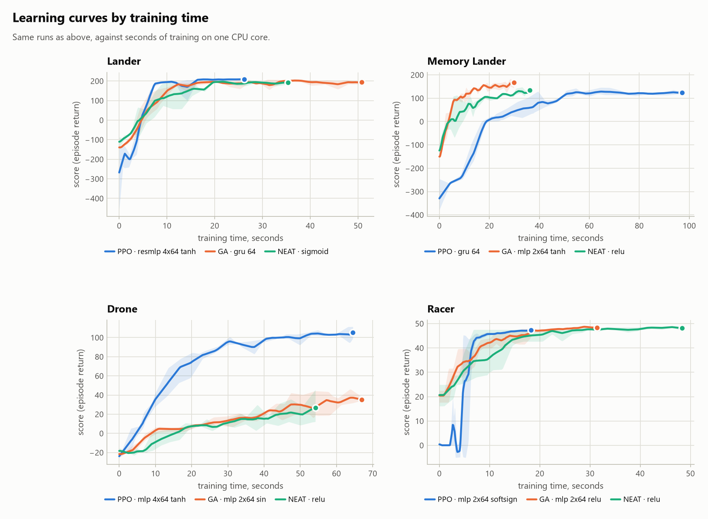

Measured by the clock the picture changes. On the lander and the racer all three get there in about the same time, the genetic algorithm is the quickest on the Memory Lander, and only on the drone is PPO still clearly ahead. A generation of the GA or NEAT is one big batched simulation with no backward pass, so it gets through its extra steps quickly.

What the best configuration of each method cost:

| Task | Method | Network | Score | Training time | Environment steps | Parameters |
|---|---|---|---|---|---|---|
| Lander | PPO | resmlp 4x64 tanh | 100% | 27 s | 0.4M | 13,188 |
| Lander | GA | gru 64 | 99% | 52 s | 4.4M | 14,084 |
| Lander | NEAT | sigmoid | 100% | 37 s | 7.5M | 60 |
| Memory Lander | PPO | gru 64 | 42% | 102 s | 0.6M | 14,468 |
| Memory Lander | GA | mlp 2x64 tanh | 76% | 30 s | 6.2M | 4,996 |
| Memory Lander | NEAT | relu | 55% | 39 s | 8.6M | 75 |
| Drone | PPO | mlp 4x64 tanh | 6.90 | 66 s | 1.0M | 13,508 |
| Drone | GA | mlp 2x64 sin | 2.50 | 68 s | 21.1M | 5,188 |
| Drone | NEAT | relu | 1.94 | 57 s | 17.3M | 95 |
| Racer | PPO | mlp 2x64 softsign | 2.51 | 19 s | 0.3M | 5,254 |
| Racer | GA | mlp 2x64 relu | 2.51 | 33 s | 4.1M | 5,254 |
| Racer | NEAT | relu | 2.54 | 49 s | 7.5M | 96 |

### 3. Activation functions

Same network (two hidden layers of 64), same PPO settings, same budget. Only the activation function changes.

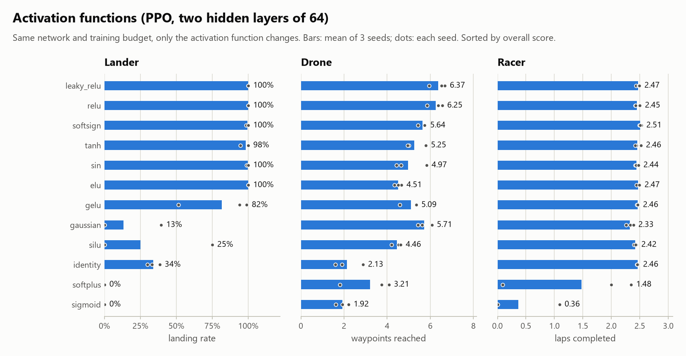

| Activation | Lander | Drone | Racer | Overall (0 to 1) |
|---|---|---|---|---|
| leaky_relu | 100% | 6.37 | 2.47 | 0.97 |
| relu | 100% | 6.25 | 2.45 | 0.96 |
| softsign | 100% | 5.64 | 2.51 | 0.94 |
| tanh | 98% | 5.25 | 2.46 | 0.91 |
| sin | 100% | 4.97 | 2.44 | 0.90 |
| elu | 100% | 4.51 | 2.47 | 0.89 |
| gelu | 82% | 5.09 | 2.46 | 0.89 |
| gaussian | 13% | 5.71 | 2.33 | 0.84 |
| silu | 25% | 4.46 | 2.42 | 0.79 |
| identity | 34% | 2.13 | 2.46 | 0.71 |
| softplus | 0% | 3.21 | 1.48 | 0.61 |
| sigmoid | 0% | 1.92 | 0.36 | 0.28 |

"Overall" is the score rescaled so that 0 is random actions and 1 is the best configuration on that task, averaged over the three tasks.

- **ReLU and leaky ReLU came top**, with softsign, tanh, sin and elu close behind.
- **The smooth ReLU look-alikes did worse than ReLU itself** on the lander: gelu landed 82% and silu 25% (one seed reached 75%, the other two never landed), against 100% for relu.
- **Sigmoid was the clear loser**: no landings at all, and two of its three seeds never got the car moving round the track. Softplus was next worst. Both give only positive outputs, which may be the common factor, but that was not tested.
- **Gaussian was erratic**: third best on the drone, 13% on the lander.
- **Identity** (a purely linear network) drove the racer as well as anything else (2.46 laps), so that task can be solved by a linear rule from the distance sensors. It did poorly on the lander and the drone.

### 4. Network shapes and kinds

Same activation (tanh), same PPO settings. Only the shape changes.

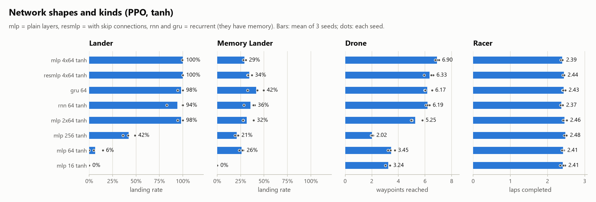

| Network | Lander | Memory Lander | Drone | Racer | Overall (0 to 1) | Parameters (drone) | Training time (drone) |
|---|---|---|---|---|---|---|---|
| mlp 4x64 tanh | 100% | 29% | 6.90 | 2.39 | 0.96 | 13,508 | 66 s |
| resmlp 4x64 tanh | 100% | 34% | 6.33 | 2.44 | 0.95 | 13,508 | 65 s |
| gru 64 | 98% | 42% | 6.17 | 2.43 | 0.94 | 15,044 | 173 s |
| rnn 64 tanh | 94% | 36% | 6.19 | 2.37 | 0.93 | 5,124 | 80 s |
| mlp 2x64 tanh | 98% | 32% | 5.25 | 2.46 | 0.91 | 5,188 | 44 s |
| mlp 256 tanh | 42% | 21% | 2.02 | 2.48 | 0.75 | 4,100 | 50 s |
| mlp 64 tanh | 6% | 26% | 3.45 | 2.41 | 0.75 | 1,028 | 36 s |
| mlp 16 tanh | 0% | 0% | 3.24 | 2.41 | 0.64 | 260 | 36 s |

- **Depth beat width.** One hidden layer was not enough to learn the landing in this budget whether it had 16, 64 or 256 units; two layers of 64 was.
- **Four layers were best on the drone** (6.90 against 5.25 for two layers). Adding skip connections did not help at this depth.
- **The very wide single layer (256) was the worst tanh network on the drone**, worse than 16 units. The learning rate was fixed for all networks and may simply be too high for a layer that wide.
- **Recurrent networks** matched the feed-forward ones where memory is not needed, at two to four times the training time. On the Memory Lander the GRU was PPO's best network, but 42% is a long way from solving it.

### 5. A different activation in each layer

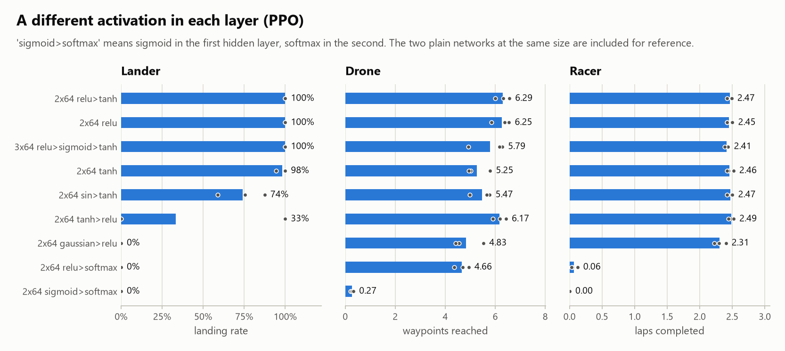

| Network | Lander | Drone | Racer | Overall (0 to 1) |
|---|---|---|---|---|
| 2x64 relu>tanh | 100% | 6.29 | 2.47 | 0.97 |
| 2x64 relu | 100% | 6.25 | 2.45 | 0.96 |
| 3x64 relu>sigmoid>tanh | 100% | 5.79 | 2.41 | 0.94 |
| 2x64 tanh | 98% | 5.25 | 2.46 | 0.91 |
| 2x64 sin>tanh | 74% | 5.47 | 2.47 | 0.91 |
| 2x64 tanh>relu | 33% | 6.17 | 2.49 | 0.88 |
| 2x64 gaussian>relu | 0% | 4.83 | 2.31 | 0.79 |
| 2x64 relu>softmax | 0% | 4.66 | 0.06 | 0.34 |
| 2x64 sigmoid>softmax | 0% | 0.27 | 0.00 | 0.08 |

- **ReLU then tanh was as good as anything tested.**
- **The order mattered.** Tanh then ReLU landed in one seed out of three (100%, 0%, 0%); ReLU then tanh landed in all three.
- **Softmax in a hidden layer was the worst thing you could do.** Softmax forces a layer's outputs to add up to one, which throws away the overall size of the signal. ReLU then softmax still managed the drone (4.66 waypoints) but could not land or drive; sigmoid then softmax could do nothing.
- **A sigmoid layer in the middle did no harm** when it sat between a ReLU layer and a tanh layer.

### 6. The same network trained two ways

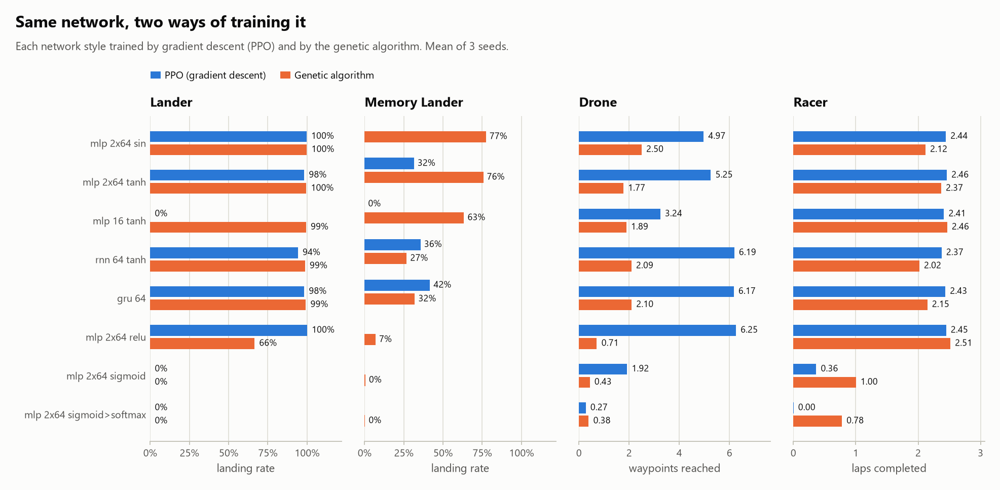

Each cell is PPO / genetic algorithm.

| Network | Lander | Memory Lander | Drone | Racer |
|---|---|---|---|---|
| mlp 2x64 sin | 100% / 100% | – / 77% | 4.97 / 2.50 | 2.44 / 2.12 |
| mlp 2x64 tanh | 98% / 100% | 32% / 76% | 5.25 / 1.77 | 2.46 / 2.37 |
| mlp 16 tanh | 0% / 99% | 0% / 63% | 3.24 / 1.89 | 2.41 / 2.46 |
| rnn 64 tanh | 94% / 99% | 36% / 27% | 6.19 / 2.09 | 2.37 / 2.02 |
| gru 64 | 98% / 99% | 42% / 32% | 6.17 / 2.10 | 2.43 / 2.15 |
| mlp 2x64 relu | 100% / 66% | – / 7% | 6.25 / 0.71 | 2.45 / 2.51 |
| mlp 2x64 sigmoid | 0% / 0% | – / 0% | 1.92 / 0.43 | 0.36 / 1.00 |
| mlp 2x64 sigmoid>softmax | 0% / 0% | – / 0% | 0.27 / 0.38 | 0.00 / 0.78 |

- **The GA could train tiny networks that PPO could not.** One hidden layer of 16 units: 99% landings with the GA, 0% with PPO.
- **The best activation depends on how you train.** ReLU was PPO's best and the GA's most unreliable: on the lander its three GA seeds scored 98%, 1% and 100%, and it failed on the Memory Lander and the drone. Tanh and sin were the GA's best.
- **Sigmoid failed with both**, so that is the activation's fault rather than the trainer's.
- **PPO was better on the drone with every network that worked at all**, usually by a factor of two or three.

### 7. NEAT

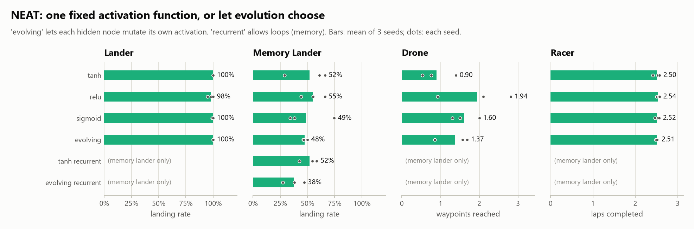

| Hidden-node activation | Lander | Memory Lander | Drone | Racer | Hidden nodes in champion | Connections in champion |
|---|---|---|---|---|---|---|
| tanh | 100% | 52% | 0.90 | 2.50 | 8.2 | 59 |
| relu | 98% | 55% | 1.94 | 2.54 | 10.8 | 66 |
| sigmoid | 100% | 49% | 1.60 | 2.52 | 8.1 | 62 |
| evolving | 100% | 48% | 1.37 | 2.51 | 7.6 | 56 |
| tanh recurrent | – | 52% | – | – | 8.7 | 47 |
| evolving recurrent | – | 38% | – | – | 7.7 | 52 |

- **NEAT's networks are tiny.** The champions have about 8 hidden nodes and 60 connections, against roughly 5,000 weights in the two-layer network. On the lander and the racer they score the same.
- **Evolving the activation functions did not help.** It never beat the best fixed choice, and it finished third or fourth of the four feed-forward variants on every task, though often by a small margin. With more generations the extra freedom might pay off; in this budget it did not.
- **Loops did not help on the Memory Lander** (52% and 38% with them, 52% and 48% without).

Which activation functions did evolution keep when it was free to choose?

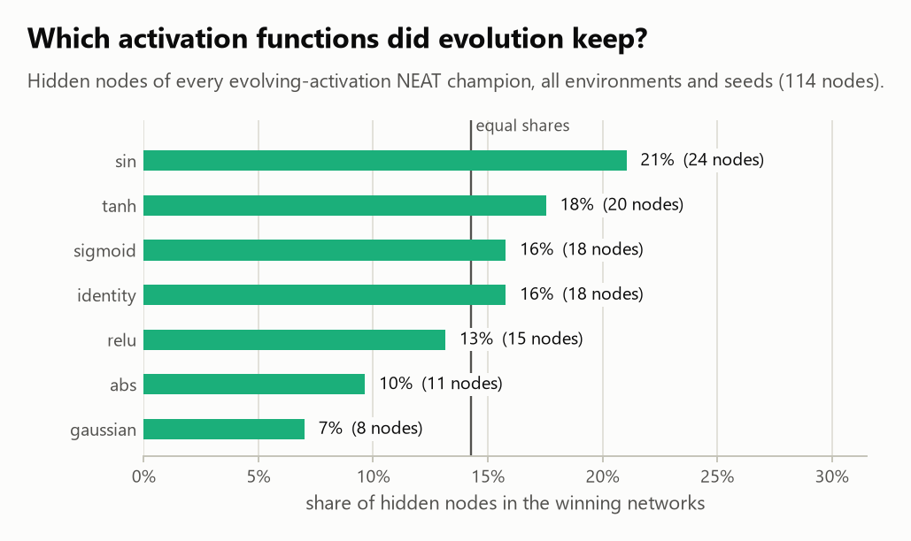

Close to an even spread. Sin was kept most often and gaussian least, but with 114 hidden nodes in total that is weak evidence of any real preference.

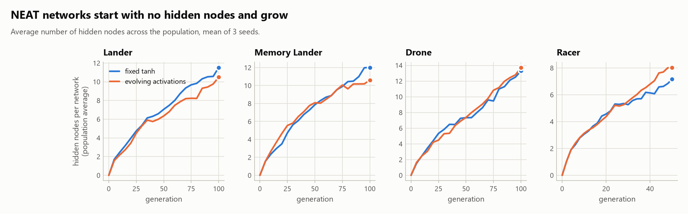

The best evolved network for each task, drawn out:

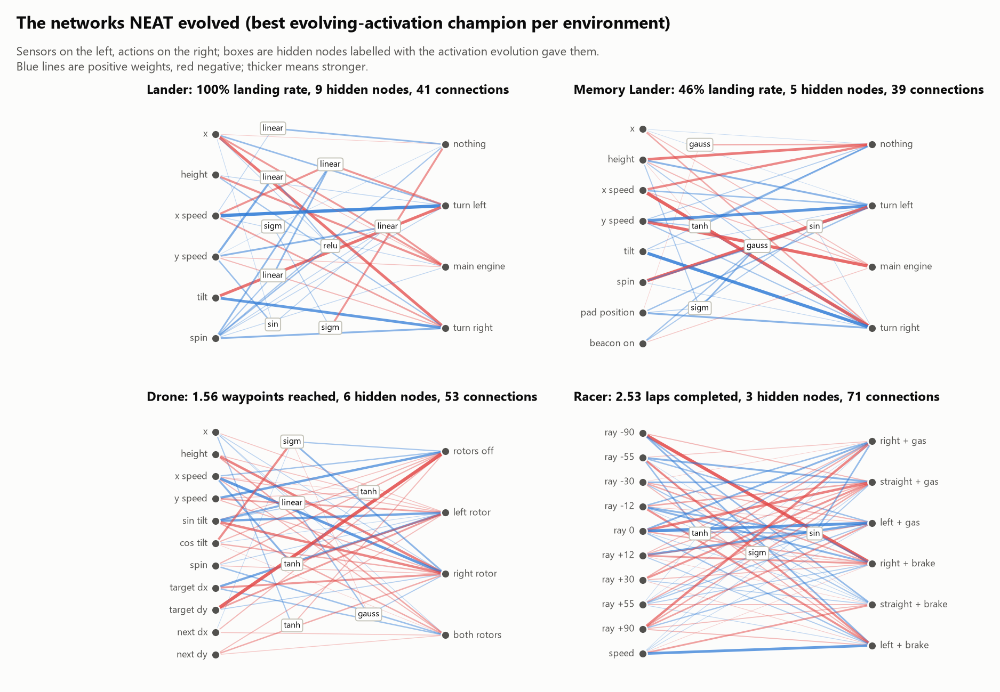

### 8. Everything at a glance

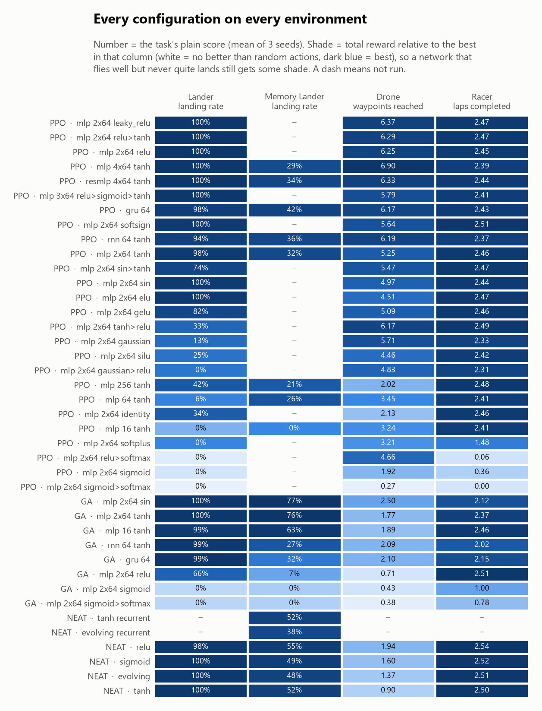

### 9. Training time against score

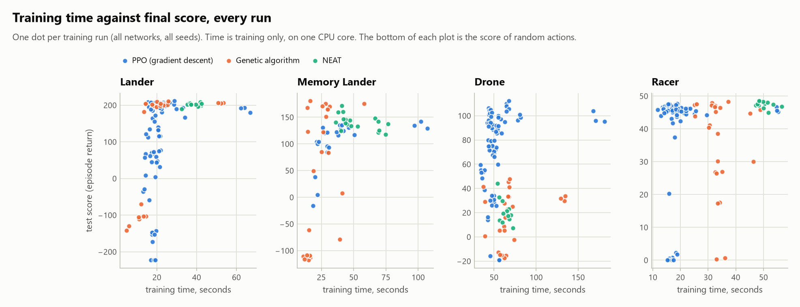

Every dot is one training run. More time did not buy a better score: the slowest runs are the recurrent networks, and they are rarely at the top.

## How the scores were measured

- **Same test for everyone.** Every trained agent, whatever made it, is scored on the same 200 test scenarios, which are never used in training. Agents act greedily (the largest output wins).
- **Checkpoint selection.** During training each run is checked about 20 times on a separate set of 64 evaluation scenarios, and the best checkpoint is the one that goes on to the test. For the GA and NEAT the top five of the generation are checked each time, because fitness from four episodes is noisy.
- **Three seeds.** Every configuration is trained three times. Tables give the mean; [RESULTS.md](RESULTS.md) also gives the spread between seeds, and the dots on the bar charts are the individual seeds.
- **Budgets.** PPO gets a fixed number of environment steps; the GA and NEAT a fixed number of generations. They were sized so a run takes very roughly a minute. Evolution uses far more environment steps in that minute than PPO does, so the learning curves are drawn both ways: against steps and against seconds.
- **Time** is the CPU time used by the training process on one core of an Intel i5-7400 (no GPU), not counting the evaluation checks. CPU time was used rather than the wall clock so that other programs running on the machine do not distort it.
- **Hyperparameters** were set once per method from a few trial runs and then left alone for every network and task. Nothing was tuned per activation function or per architecture.
- **Repeatable.** Running the same configuration and seed again gives exactly the same score (checked on 140 of the runs).

Budgets and settings are all in [`arena/experiments.py`](arena/experiments.py).

## What this does not show

- **These are small tasks and small networks.** A ranking of activation functions here says little about image models or language models.
- **Three seeds is few.** Where two configurations are close, the order between them is not reliable.
- **One set of hyperparameters per method.** An activation function or shape that does badly here might do fine with a different learning rate or initialisation. PPO's settings were chosen on a tanh network, and every network uses the same orthogonal initialisation, which will suit some activations better than others.
- **A fixed budget is not a ceiling.** "Failed to land" means "did not learn to land in this budget", not "cannot".
- **The time comparison is specific to this code and this CPU.** The GA and NEAT are simulated in big batches; PPO spends most of its time in small PyTorch updates. A GPU, or a different implementation, would shift the picture.
- **The reasons offered above are guesses unless stated otherwise.** The experiments show what happened, not why.
- **NEAT's output nodes are always linear**, and softmax cannot be a per-node activation, so it is not in NEAT's menu.

## Run it yourself

Needs Python 3.10 or newer.

```bash
pip install -r requirements.txt
```

```bash
python -m pytest -q
```

Watch a trained agent live (the champions used for the GIFs are in the repository):

```bash
python watch.py lander --method neat
```

Re-run everything (about an hour and a half on a four-core desktop; runs already done are skipped, so it can be stopped and restarted):

```bash
python run.py
```

```bash
python report.py
```

```bash
python make_gifs.py
```

Useful variations: `python run.py --suite neat` runs one suite (`activations`, `architectures`, `mixed`, `ga`, `neat`), `python run.py --only drone` runs anything with "drone" in its name, and `python run.py --scale 0.05 --out trial` does a five-minute miniature of the whole thing into a separate folder.

To add a network style, add a `NetSpec` to the lists in `arena/experiments.py`. To add a task, subclass `VecEnv` in `arena/envs/` (the Lander is the shortest example).

## What is in the repository

```
arena/
  envs/            the four tasks (lander.py, drone.py, racer.py) and their drawing code
  activations.py   the activation functions
  nets.py          network styles: MLP, residual MLP, Elman RNN, GRU
  ppo.py           gradient-descent trainer
  ga.py            genetic algorithm
  neat.py          NEAT, with optional evolving activations and recurrent links
  evaluate.py      shared scoring, saving and loading
  experiments.py   the list of experiments and their budgets
  render.py        GIF helpers
run.py             runs the experiments in parallel
report.py          builds the graphs, the CSV files, RESULTS.md and results/tables.md
make_gifs.py       renders the side-by-side GIFs
watch.py           live viewer
tests/             unit tests
results/
  runs/            one JSON file per training run (scores and learning curve)
  figures/         the graphs
  gifs/            the animations
  champions/       the best trained agent of each method on each task
  summary.csv      one row per configuration
  all_runs.csv     one row per run
  tables.md        the tables quoted in this README
RESULTS.md         every configuration on every task, as tables
```

## Licence

MIT. See [LICENSE](LICENSE).
